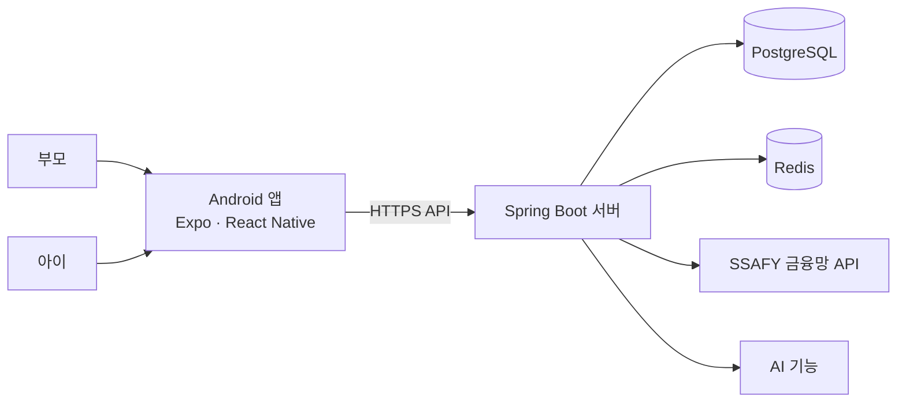

# 🌰 도토리

> 부모가 만든 안전한 가정 내 경제 시스템에서 아이가 도토리 포인트를 벌고, 모으고, 쓰고, 투자하며 금융 개념을 경험하는 Android 서비스

<p align="center">
  <strong>설명으로 배우는 금융이 아니라, 우리 집 안에서 직접 경험하는 금융</strong>
</p>

<!--
대표 이미지가 준비되면 아래 경로에 추가합니다.
- 권장 경로: docs/images/readme/hero.png
- 권장 내용: 도토리 로고와 부모·아이 주요 화면

<p align="center">
  
</p>
-->

## 프로젝트 개요

| 구분 | 내용 |
| --- | --- |
| 프로젝트명 | 도토리 |
| 개발 상태 | 개발 진행 중 |
| 대상 플랫폼 | Android 우선 지원 |
| 핵심 사용자 | 초등학교 4~6학년 자녀와 보호자 |
| 팀 구성 | 총 6명 |

초등학생은 돈을 직접 벌고 저축하거나 소비하는 경험이 적어 금융 개념을 설명으로만 접하는 경우가 많습니다. 부모 역시 용돈과 보상을 통해 올바른 경제 습관을 알려주고 싶지만, 일관된 기준과 지속 가능한 방법을 만들기 어렵습니다.

**도토리**는 부모가 가정 안의 경제 규칙을 만들고 아이가 그 안에서 소득, 저축, 소비, 투자 과정을 직접 경험하도록 돕습니다. 모든 활동은 가족 단위의 안전한 환경에서 이루어지며, 아이는 자신의 선택이 포인트 변화와 결과로 이어지는 과정을 자연스럽게 학습합니다.

## 핵심 사용자

### 부모

- 자녀의 경제 습관을 지도하고 싶은 보호자
- 가족 그룹과 가정 내 경제 환경을 관리하는 사용자
- 아이의 활동과 환전 요청, 경제활동 결과를 확인하는 사용자
- 아이가 구매할 수 있는 상점 상품을 등록하는 사용자

### 아이

- 금융 경험이 부족한 초등학교 4~6학년
- 미션과 보상 방식에 익숙한 사용자
- 행동과 선택의 결과를 포인트 변화로 경험하는 사용자

## 핵심 가치

1. **경험형 금융교육**
   설명을 읽는 데서 그치지 않고 소득 → 저축 → 소비 → 투자의 흐름을 직접 경험합니다.

2. **가족 맞춤형 경제**
   가족마다 생활 방식에 맞는 미션과 상점 상품을 구성해 우리 집만의 경제 환경을 만듭니다.

3. **안전한 금융 경험**
   가족 그룹 안에서 부모와 아이의 역할을 분리하고, 보호자가 아이의 경제활동을 함께 살펴봅니다.

4. **지속적인 참여 동기**
   다람쥐와 도토리 세계관, 성장과 보상을 통해 금융 활동을 친숙하고 재미있는 경험으로 만듭니다.

## 도토리 세계관

도토리는 다람쥐가 도토리를 모으고 활용하는 모습을 아이의 경제활동과 연결합니다. 아이는 미션을 수행해 도토리 포인트를 벌고, 필요한 곳에 쓰거나 미래를 위해 모으며, 선택에 따른 결과를 경험합니다.

- **도토리 포인트**: 아이의 소득과 경제활동을 표현하는 서비스 내 재화
- **모으기**: 예금과 적금을 통한 저축 경험
- **사용하기**: 부모가 만든 상점에서의 소비 경험
- **불리기**: 가상 투자를 통한 수익과 위험 경험
- **성장하기**: 퀴즈, 단어장, 리포트를 통한 금융 지식 축적

> `10원 = 1P`의 고정 비율을 사용합니다. 아이는 부모에게 포인트 환전을 요청하고, 부모는 실제 용돈 지급을 처리합니다.

## 서비스 진입 흐름


## 주요 기능

### 1. 가족 연결과 역할 분리

- 회원가입 및 로그인
- 부모와 아이 역할 선택
- 부모의 가족 그룹 생성과 초대 코드 발급
- 아이의 초대 코드 입력을 통한 가족 연결
- 가족 단위 권한과 데이터 분리

### 2. 실계좌 연동과 도토리 지갑

- SSAFY 금융망 API를 활용한 계좌 연동
- 연결 계좌와 거래 내역 조회
- 도토리 포인트 잔액과 거래 내역 확인
- 가족 구성원 간 포인트 이전
- 아이의 환전 요청과 부모의 용돈 지급 처리

### 3. 소득과 소비

- 집안일과 활동을 통한 도토리 포인트 획득
- 소득·소비 내역 기록과 확인
- 행동의 결과를 포인트 변화로 즉시 경험

### 4. 포인트 기반 예금·적금

- 실제 금융상품이 아닌 도토리 포인트 기반의 가상 예·적금
- 포인트를 일정 기간 모으고 이자를 받는 저축 경험
- 만기와 결과를 통해 저축의 개념 학습

### 5. 우리 집 상점

- 부모가 아이를 위한 상품과 가격 등록
- 아이가 보유 포인트로 상품 구매
- 별도의 구매 후 승인 없이 구매와 함께 포인트 차감
- 소비 선택과 잔액 변화를 직접 확인

### 6. 투자와 금융 학습

- 포인트 기반 가상 투자 경험
- 금융 퀴즈를 통한 개념 확인
- 금융 단어장을 통한 용어 학습
- AI 학습 도우미를 활용한 쉬운 설명과 학습 지원

### 7. AI 경제 설계와 리포트

- 가족 상황을 바탕으로 우리 집 경제 시스템 구성 지원
- 주간 경제활동 정산
- 소득, 소비, 저축, 투자 활동 요약
- 부모를 위한 자녀 경제활동 리포트

## 개발 단계별 범위

| 단계 | 목표 | 포함 기능 |
| --- | --- | --- |
| **1차 — 기반 시스템** | 가족 경제활동의 기반 마련 | 회원가입·로그인, 가족 그룹, 실계좌 연동, 포인트 지갑, 환전 요청 |
| **2차 — 주요 경제활동** | 돈을 벌고 모으고 쓰는 과정 구현 | 소득, 소비, 예·적금, 상점 |
| **2.5차 — 금융 경험 확장** | 선택과 학습 영역 확장 | 가상 투자, 금융 퀴즈, 금융 단어장 |
| **3차 — 서비스 고도화** | 활동 결과를 이해하고 지속하도록 지원 | AI 경제 설계, 주간 정산, 부모 리포트, 알림, 사용성 개선 및 이슈 해결 |

<!--
실제 화면이 준비되면 아래와 같은 구성을 추가합니다.

## 서비스 화면

| 부모 홈 | 아이 홈 | 도토리 지갑 |
| --- | --- | --- |
| 이미지 | 이미지 | 이미지 |

| 예·적금 | 우리 집 상점 | 투자·퀴즈 |
| --- | --- | --- |
| 이미지 | 이미지 | 이미지 |

권장 경로:
- docs/images/readme/screen-parent-home.png
- docs/images/readme/screen-child-home.png
- docs/images/readme/screen-wallet.png
- docs/images/readme/screen-saving.png
- docs/images/readme/screen-store.png
- docs/images/readme/screen-learning.png
-->

## 시스템 구성



> 현재 저장소에 마련된 기반 구성을 나타냅니다. 인증, AI 연동, 배포 구조가 확정되면 실제 운영 아키텍처로 갱신할 예정입니다.

## 기술 스택

| 영역 | 기술 |
| --- | --- |
| **Mobile** | React Native 0.86, React 19, TypeScript 6, Expo 57, Expo Router |
| **Client State & Data** | TanStack Query, Zustand, Axios |
| **Backend** | Java 21, Spring Boot 4.1, Spring Security, Spring Data JPA, Spring Batch |
| **Database** | PostgreSQL 16, Redis 7 |
| **External API** | SSAFY 금융망 API |
| **Infrastructure** | Docker, Docker Compose |
| **Test** | Jest, React Native Testing Library, JUnit 5 |

## 디렉터리 구조

```text
S15P21A505/
├── frontend/                  # Expo·React Native Android 앱
│   ├── src/app/               # 화면과 라우팅
│   ├── src/features/          # 사용자 기능
│   ├── src/widgets/           # 화면 단위 조합 UI
│   └── src/shared/            # 공통 UI, API, 설정
├── backend/                   # Spring Boot API 서버
│   └── src/
├── docs/                      # 기획, 설계, API 및 협업 문서
├── docker-compose.local.yml   # PostgreSQL·Redis 로컬 환경
└── .env.example              # 로컬 환경변수 예시
```

## 로컬 실행

### 사전 요구 사항

- Node.js 및 npm
- JDK 21
- Docker Engine 및 Docker Compose

### 1. PostgreSQL·Redis 실행

```bash
docker compose -f docker-compose.local.yml up -d
```

### 2. Backend 실행

```bash
cd backend
./gradlew bootRun
```

Windows에서는 다음 명령을 사용할 수 있습니다.

```powershell
cd backend
.\gradlew.bat bootRun
```

### 3. Frontend 실행

```bash
cd frontend
npm ci
npm start
```

환경변수는 루트와 `frontend/`의 `.env.example`을 참고해 별도의 `.env` 파일에 작성합니다. 비밀값은 저장소에 커밋하지 않습니다.

## 팀

| 이름 | 역할 |
| --- | --- |
| 서진주 | 팀장, AI |
| 김상현 | 인프라, 백엔드 |
| 이영주 | 풀스택 |
| 김인송 | 풀스택 |
| 김태수 | 백엔드 |
| 천명석 | 백엔드 |

개인별 세부 담당 기능과 기여 내용은 개발 진행에 맞춰 갱신할 예정입니다.

## 협업 규칙

- 작업 브랜치 → `dev` → `master` 순서로 병합합니다.
- `dev`와 `master`에는 직접 push하지 않고 Merge Request를 사용합니다.
- 브랜치 및 커밋 규칙은 [`docs/CONVENTIONS.md`](docs/CONVENTIONS.md)를 따릅니다.

<!--
아래 자료가 확정되면 README에 추가합니다.

- 실제 서비스 화면과 시연 GIF
- 시스템 아키텍처 이미지
- ERD
- API 문서 또는 Swagger 링크
- APK 또는 배포 링크
- 발표 영상과 서비스 소개 자료
- 팀원 GitHub/GitLab 링크와 개인별 기여 내용
-->
