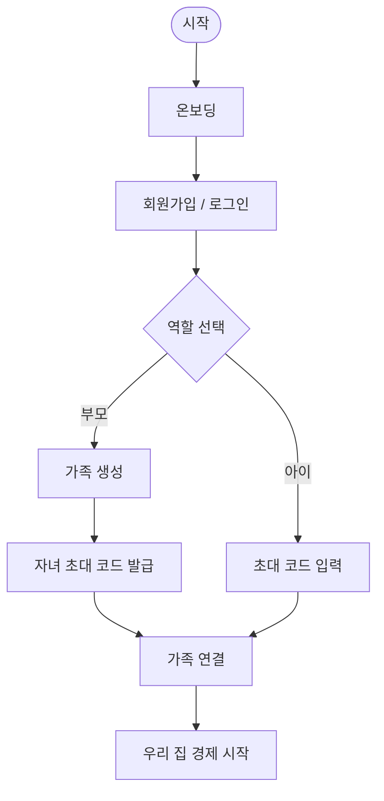
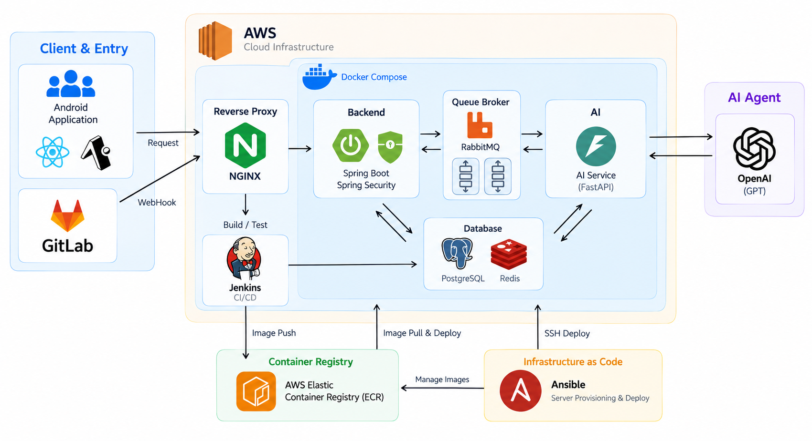
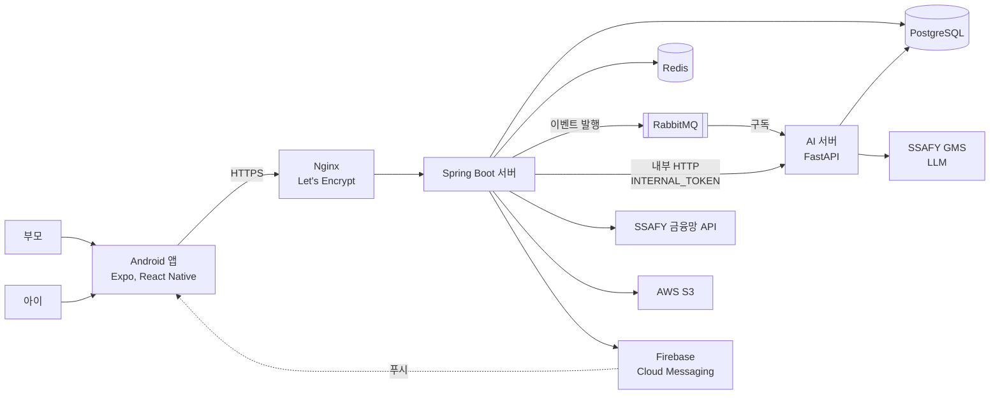

# 🌰 도토리

> SSAFY 15기 핀테크 특화 프로젝트 | 가상 경제 생태계 기반 어린이 교육 앱 서비스


<p align="center">
  <strong>용돈에서 시작되는 나만의 작은 경제, 도토리</strong>
</p>


<p align="center">
  🖼️ 발표 자료 : <a href="https://drive.google.com/file/d/1JLz0FKAuvyTtFMBCuY77-vADp_EKBol5/view?usp=sharing">PDF</a> | 📹 영상 포트폴리오 : <a href="https://drive.google.com/file/d/1Mqpf7uP-xShJs5vi2MU_hXL8wKYIx1CX/view?usp=sharing">MP4</a> 
</p>


<!--
대표 이미지가 준비되면 아래 경로에 추가합니다.
- 권장 경로: docs/images/readme/hero.png
- 권장 내용: 도토리 로고와 부모, 아이 주요 화면

<p align="center">
  
</p>
-->

## 목차

- [프로젝트 개요](#프로젝트-개요) | [팀](#팀) | [핵심 사용자](#핵심-사용자) | [핵심 가치](#핵심-가치) | [도토리 세계관](#도토리-세계관)
- [서비스 진입 흐름](#서비스-진입-흐름) | [주요 기능](#주요-기능) | [개발 단계별 범위](#개발-단계별-범위)
- [시스템 구성](#시스템-구성) | [주요 설계 포인트](#주요-설계-포인트) | [ERD](#erd) | [API 명세](#api-명세)
- [기술 스택](#기술-스택) | [디렉터리 구조](#디렉터리-구조) | [로컬 실행](#로컬-실행)
- [협업 규칙](#협업-규칙) | [문서](#문서)

## 프로젝트 개요

| 구분 | 내용 |
| --- | --- |
| 프로젝트 | 가상 경제 생태계 기반 어린이 교육 앱 서비스 '도토리' |
| 기간 | 26.08.18 ~ 26.09.28 |
| 서비스 개요 | 부모가 만든 안전한 가정 내 경제 시스템에서 아이가 도토리 포인트를 벌고, 모으고, 쓰고, 투자하며 금융 개념을 경험하는 Android 서비스 |
| 대상 플랫폼 | Android 우선 지원 |
| 핵심 사용자 | 초등학교 4~6학년 자녀와 보호자 |
| 팀 구성 | 총 6명 |

### 초등학생
- 돈을 직접 벌고 저축하거나 소비하는 경험이 적어 금융 개념을 설명으로만 접하는 경우가 많습니다.
- 부모 역시 용돈과 보상을 통해 올바른 경제 습관을 알려주고 싶지만, 일관된 기준과 지속 가능한 방법을 만들기 어렵습니다.

### 도토리
- **부모**가 **가정 안의 경제 규칙**을 만들고
- **아이**가 그 안에서 **소득, 저축, 소비, 투자** 과정을 **직접 경험**하도록 돕습니다.
- 모든 활동은 **가족 단위**로 형성된 **가상의 금융 생태계** 내에서 이루어지며, 
- 아이는 자신의 선택이 포인트 변화와 같은 경제적 결과로 이어지는 과정을 자연스럽게 학습합니다.

## 팀

| 이름 | 서진주 | 김상현 | 이영주 | 김인송 | 김태수 | 천명석 |
| --- | --- | --- | --- | --- | --- | --- |
| 역할 | 팀장, AI | 인프라, 백엔드 | 풀스택 | 풀스택 | 백엔드 | 백엔드 |


## 핵심 사용자

<table>
  <tr>
    <th width="50%">🦉 부모</th>
    <th width="50%">🐿️ 아이</th>
  </tr>
  <tr>
    <td align="center"></td>
    <td align="center"></td>
  </tr>
  <tr>
    <td valign="top">
      <ul>
        <li>자녀의 경제 습관을 지도하고 싶은 보호자</li>
        <li>가족 그룹과 가정 내 경제 환경을 관리하는 사용자</li>
        <li>아이의 활동과 환전 요청, 경제활동 결과를 확인하는 사용자</li>
        <li>아이가 구매할 수 있는 상점 상품을 등록하는 사용자</li>
      </ul>
    </td>
    <td valign="top">
      <ul>
        <li>금융 경험이 부족한 초등학교 4~6학년</li>
        <li>미션과 보상 방식에 익숙한 사용자</li>
        <li>행동과 선택의 결과를 포인트 변화로 경험하는 사용자</li>
      </ul>
    </td>
  </tr>
</table>

## 핵심 가치

1. **경험형 금융교육**
   | 설명을 읽는 데서 그치지 않고 소득 → 저축 → 소비 → 투자의 흐름을 직접 경험합니다.

2. **가족 맞춤형 경제**
   | 가족마다 생활 방식에 맞는 미션과 상점 상품을 구성해 우리 집만의 경제 환경을 만듭니다.

3. **안전한 금융 경험**
   | 가족 그룹 안에서 부모와 아이의 역할을 분리하고, 보호자가 아이의 경제활동을 함께 살펴봅니다.

4. **지속적인 참여 동기**
   | 다람쥐와 도토리 세계관, 성장과 보상을 통해 금융 활동을 친숙하고 재미있는 경험으로 만듭니다.

## 도토리 세계관

도토리는 다람쥐가 도토리를 모으고 활용하는 모습을 아이의 경제활동과 연결합니다. 아이는 미션을 수행해 도토리 포인트를 벌고, 필요한 곳에 쓰거나 미래를 위해 모으며, 선택에 따른 결과를 경험합니다.

- **도토리 포인트**: 아이의 소득과 경제활동을 표현하는 서비스 내 재화
- **모으기**: 예금과 적금을 통한 저축 경험
- **사용하기**: 부모가 만든 상점에서의 소비 경험
- **불리기**: 가상 투자를 통한 수익과 위험 경험
- **성장하기**: 퀴즈, 단어장, 리포트를 통한 금융 지식 축적

> `10원 = 1P`의 고정 비율을 사용합니다. 아이는 부모에게 포인트 환전을 요청하고, 부모는 실제 용돈 지급을 처리합니다.

## 서비스 진입 흐름



## 주요 기능

### 💳 실계좌 연동과 도토리 지갑

- 실계좌 연동
  - SSAFY 금융망 API 기반 계좌 연동 (1원 인증)
  - 연동 계좌 잔액 실시간 조회, 계좌 간 이체
- 현금과 포인트의 연결 (`10원 = 1P`)
  - 충전: 아이 계좌에서 부모 계좌로 송금 → 같은 금액만큼 포인트 발행
  - 환전: 아이가 요청 → 부모 승인 시 부모 계좌에서 아이 계좌로 송금 (거절, 취소 시 포인트 환급)
  - 도토리 주기: 부모가 자녀에게 포인트 직접 지급
- 거래 내역 확인
  - 실계좌 거래 내역: 기간(1주, 1개월, 3개월, 직접 지정), 입금과 출금 필터, 무한 스크롤
  - 포인트 거래 내역: 충전, 보상, 구매, 저축, 투자 등 유형별 조회
  - 부모도 자녀의 포인트 잔액과 거래 내역 열람 가능

### 🧹 미션

- 부모가 자녀별 할 일 등록 (한 번, 매일, 매주, 매월 반복)
- AI가 난이도와 가족 용돈 수준을 바탕으로 보상 포인트 책정
- 아이가 사진으로 완료 인증 요청 → 부모 승인 시 포인트 지급, 거절 가능
- 완료 내역은 실제 지급액 기준으로 기록 (보상을 나중에 바꿔도 과거 이력 유지)

### 🏪 상점

- 부모가 아이를 위한 상품 등록
- AI가 상품 가치와 가족 소득 수준을 바탕으로 포인트 가격 책정
- 아이가 보유 포인트로 즉시 구매 (구매 후 별도 승인 없이 바로 차감)
- 구매 내역 조회로 소비 선택과 잔액 변화 확인

### 🏦 예적금

- 포인트 기반 가상 저축 상품 6종
  - 자유 입출금: 매주 잔액 기준 이자 지급
  - 예금(단리, 복리): 가입 시 1회 납입, 4주 만기
  - 적금(2주, 4주, 6주): 매주 정해진 금액 납입
- 가입일 기준 주간 정산, 만기 수령, 중도 해지 (원금만 반환)
- 만기 예상 수령액과 지금 해지 시 수령액 비교
- 적금 납입 리마인더 알림

### 📈 투자

- 매일 AI가 가상 기업 뉴스 생성 → 다음 날 뉴스 내용에 따라 종목 가격 변동
- 가족별 독립 시세, 종목당 1주 매수와 매도
- 보유 종목, 거래 내역, 가격 이력 조회
- 뉴스 리뷰로 가격이 오르내린 이유 복습

### 📝 퀴즈

- 매일 가족의 금융 지식 수준에 맞춘 AI 경제 퀴즈 출제
- 정답 시 포인트 보상, 풀이 이력 조회
- 부모는 정답과 아이의 제출 내역 확인
- 경제 단어장: 금융 용어 검색과 쉬운 설명

### 공통 기반

- 가족 연결: 부모가 가족 생성, 초대 코드로 아이 연결, 가족 단위 권한 분리
- 온보딩 설정: 주간 용돈, 주간 보상 한도, 금융 지식 수준 (AI 가격, 보상, 퀴즈 난이도의 기준)
- 리포트: 자녀의 수입, 소비, 자산 리포트
- 알림: FCM 푸시와 알림 센터 (하루 시작 알림, 승인 요청, 납입 리마인더 등)

## 개발 단계별 범위

| 단계 | 목표 | 포함 기능 |
| --- | --- | --- |
| **1차 — 기반 시스템** | 가족 경제활동의 기반 마련 | 회원가입, 로그인, 가족 그룹, 실계좌 연동, 포인트 지갑, 환전 요청 |
| **2차 — 주요 경제활동** | 돈을 벌고 모으고 쓰는 과정 구현 | 소득, 소비, 예적금, 상점 |
| **2.5차 — 금융 경험 확장** | 선택과 학습 영역 확장 | 가상 투자, 금융 퀴즈, 금융 단어장 |
| **3차 — 서비스 고도화** | 활동 결과를 이해하고 지속하도록 지원 | AI 경제 설계, 주간 정산, 부모 리포트, 알림, 사용성 개선 및 이슈 해결 |

<!--
실제 화면이 준비되면 아래와 같은 구성을 추가합니다.

## 서비스 화면

| 부모 홈 | 아이 홈 | 도토리 지갑 |
| --- | --- | --- |
| 이미지 | 이미지 | 이미지 |

| 예적금 | 우리 집 상점 | 투자, 퀴즈 |
| --- | --- | --- |
| 이미지 | 이미지 | 이미지 |

권장 경로:
- docs/images/readme/screen-parent-home.png
- docs/images/readme/screen-child-home.png
- docs/images/readme/screen-wallet.png
- docs/images/readme/screen-saving.png
- docs/images/readme/screen-store.png
- docs/images/readme/screen-learning.png
-->

## 시스템 구성

<p align="center">
  
</p>



- EC2 서버에 한 대에 Nginx(호스트)와 Docker Compose 스택(백엔드, AI, PostgreSQL, Redis, RabbitMQ)을 함께 운영
- AI 서버는 외부에 포트를 열지 않고 Compose 네트워크 안에서 Spring만 호출
- 배포는 Jenkins가 이미지를 빌드해 AWS ECR에 push하고, Ansible playbook으로 서버를 구성

### 주요 설계 포인트

- **포인트 충전과 환전의 정합성**: 지갑 비관적 락 + 멱등키(UNIQUE 제약)로 이중 처리 방지, 송금 실패 시 같은 트랜잭션에서 포인트를 환급하는 보상 트랜잭션
- **RabbitMQ 비동기 처리**: 상품, 할 일 등록은 즉시 응답하고 커밋 후(`AFTER_COMMIT`) 발행, AI 서버가 DB 최신 값으로 가격과 보상 산정
- **정기 작업**: 뉴스, 퀴즈 생성과 예적금 정산 등 KST 크론 6종, AI 쪽 작업은 모두 멱등이라 재호출 안전
- **인증**: JWT access(30분) + refresh(14일), refresh는 해시 저장 후 재발급마다 회전
- **자산 보호**: 자산이 남은 자녀는 탈퇴, 가족 해체, 제외 불가, 가족 해체는 소프트 삭제로 이력 보존

> 자세한 내용은 [`docs/설계포인트.md`](docs/설계포인트.md)를 참고합니다.

## ERD

PostgreSQL 16, 27개 테이블 (사용자, 가족, 계좌, 지갑, 할 일, 예적금, 상점, 투자, 학습, 알림)

```mermaid
erDiagram
    %% 사용자와 가족
    users ||--o{ family_members : "소속"
    families ||--o{ family_members : "구성원"
    users ||--o{ families : "생성"
    families ||--o{ family_codes : "초대 코드"
    users ||--o{ linked_accounts : "계좌 연동"
    users ||--o{ refresh_tokens : "인증"
    users ||--o{ notifications : "알림"
    users ||--o{ device_tokens : "푸시 기기"

    %% 지갑
    users ||--o| point_wallets : "지갑"
    users ||--o{ point_transactions : "포인트 거래"
    users ||--o{ point_cashout_requests : "환전 요청"

    %% 할 일
    families ||--o{ chores : "할 일"
    chores ||--o{ chore_completion_requests : "완료 요청"

    %% 예적금
    savings_products ||--o{ savings_subscriptions : "상품"
    users ||--o{ savings_subscriptions : "가입"
    savings_subscriptions ||--o{ savings_transactions : "납입, 지급"

    %% 상점
    families ||--o{ store_products : "상품 등록"
    store_products ||--o{ purchases : "구매"
    users ||--o{ purchases : "구매자"

    %% 투자
    investment_products ||--o{ investment_price_history : "가격 이력"
    investment_products ||--o{ investment_holdings : "보유"
    investment_products ||--o{ investment_transactions : "매매"
    users ||--o{ investment_holdings : "보유자"
    investment_news ||--o{ investment_news_products : "관련 종목"
    investment_products ||--o{ investment_news_products : "뉴스"

    %% 학습
    words ||--o{ quizzes : "출제 단어"
    users ||--o{ quizzes : "배정"
    quizzes ||--o{ quiz_attempts : "풀이"
```



> 핵심 관계만 표시한 간략도입니다. 도메인별 테이블 목록과 스키마 링크는 [`docs/ERD.md`](docs/ERD.md)를 참고합니다.

## API 명세

- 공개 API 99개, 모든 경로는 `/api/v1` 프리픽스
- 인증은 `Authorization: Bearer <access token>`, 에러 응답은 `{ code, message, timestamp }`로 통일

| Method | Path | 설명 |
| --- | --- | --- |
| `POST` | `/auth/login` | 로그인, access와 refresh 토큰 발급 |
| `POST` | `.../wallet/charge` | 포인트 충전 (아이 계좌에서 부모 계좌로 송금, 같은 금액만큼 포인트 발행) |
| `POST` | `.../wallet/cashout-requests/{cashoutRequestId}/approve` | 환전 승인 (송금 실패 시 포인트 환급) |
| `POST` | `.../chores/completion-requests/{requestId}/approve` | 할 일 완료 승인, 보상 지급 |
| `POST` | `/families/{familyId}/store/products/{productId}/purchases` | 상점 상품 구매 |
| `POST` | `/investments/orders/buy` | 투자 종목 매수 |

> 경로는 `/api/v1`을 생략했고, `...`은 `/families/{familyId}/children/{childId}`를 줄인 것입니다. 도메인별 엔드포인트는 [`docs/API명세.md`](docs/API명세.md)를 참고합니다.

## 기술 스택

| 영역 | 기술 |
| --- | --- |
| **Mobile** |      |
| **Client State & Data** |    |
| **Backend** |      |
| **AI** |      |
| **Database** |   |
| **Messaging** |    |
| **Push / Storage** |   |
| **External API** |    |
| **API Docs** |  |
| **Infrastructure** |      |
| **CI/CD** |    |
| **Test** |     |


## 디렉터리 구조

```text
S15P21A505/
├── frontend/                  # Expo, React Native Android 앱
│   ├── src/app/               # 화면과 라우팅
│   ├── src/features/          # 사용자 기능
│   ├── src/widgets/           # 화면 단위 조합 UI
│   └── src/shared/            # 공통 UI, API, 설정
├── backend/                   # Spring Boot API 서버
│   ├── src/
│   └── docker/initdb/         # DB 스키마, 시드 SQL
├── AI/                        # FastAPI AI 서버 (LLM 기능, RabbitMQ 컨슈머)
├── docs/                      # 기획, 설계, API 및 협업 문서
├── exec/                      # 로컬 실행, 포팅 매뉴얼, 서버 설정, 시연 시나리오
├── docker-compose.local.yml   # PostgreSQL, Redis, RabbitMQ 로컬 환경
└── .env.example              # 로컬 환경변수 예시
```

## 로컬 실행

Docker Compose로 PostgreSQL, Redis, RabbitMQ를 띄운 뒤 백엔드, 앱, AI 서버를 실행합니다. 
- 사전 요구 사항과 단계별 명령은 [`exec/로컬실행.md`](exec/로컬실행.md)를 참고합니다.

> 운영 서버 배포(EC2, Jenkins, Ansible)는 [포팅 매뉴얼](exec/포팅메뉴얼.md)을 참고합니다.

## 협업 규칙

- 작업 브랜치 → `dev` → `master` 순서로 병합합니다.
- `dev`와 `master`에는 직접 push하지 않고 Merge Request를 사용합니다.
- 브랜치 및 커밋 규칙은 [`docs/CONVENTIONS.md`](docs/CONVENTIONS.md)를 따릅니다.

## 문서

| 문서 | 내용 |
| --- | --- |
| [`docs/Idea.md`](docs/Idea.md) | 기획, 타겟 사용자, 기능 목록 |
| [`docs/ARCHITECTURE.md`](docs/ARCHITECTURE.md) | 아키텍처, ERD 요약, 도메인 규칙 |
| [`docs/설계포인트.md`](docs/설계포인트.md) | 동시성, 멱등성, 보상 트랜잭션, 비동기 처리 등 설계 상세 |
| [`docs/ERD.md`](docs/ERD.md) | ERD 다이어그램, 도메인별 테이블 |
| [`docs/API명세.md`](docs/API명세.md) | API 규칙과 대표 엔드포인트 |
| [`docs/CONVENTIONS.md`](docs/CONVENTIONS.md) | Git 브랜치 전략, 커밋 규칙 |
| [`exec/로컬실행.md`](exec/로컬실행.md) | 로컬 개발 환경 실행 절차 |
| [`exec/포팅메뉴얼.md`](exec/포팅메뉴얼.md) | 빌드와 배포 절차, 사용 기술 버전, 배포 특이사항 |
| [`exec/환경변수.md`](exec/환경변수.md) | 백엔드, AI 서버, 앱, 배포 설정의 환경변수 |
| [`exec/서버설정.md`](exec/서버설정.md) | Nginx, Docker Compose, Jenkins, 방화벽 설정 |
| [`exec/DB.md`](exec/DB.md) | DB 접속 정보, 스키마, 덤프 |
| [`exec/외부서비스.md`](exec/외부서비스.md) | 금융망, GMS, S3, FCM 등 외부 서비스 발급 방법 |
| [`exec/시연시나리오.md`](exec/시연시나리오.md) | 시연 순서와 대사 |
| [`AI/README.md`](AI/README.md) | AI 서버 구조, 엔드포인트, 배치 스크립트 |
| [`frontend/README.md`](frontend/README.md) | 앱 구조와 개발 방법 |
