# ERD

[← README로 돌아가기](../ReadMe.md)

```mermaid
erDiagram
    %% 사용자와 가족
    users ||--o{ family_members : "소속"
    families ||--o{ family_members : "구성원"
    users ||--o{ families : "생성"
    families ||--o{ family_codes : "초대 코드"
    users ||--o{ linked_accounts : "계좌 연동"
    users ||--o{ refresh_tokens : "인증"
    users ||--o{ notifications : "알림"
    users ||--o{ device_tokens : "푸시 기기"

    %% 지갑
    users ||--o| point_wallets : "지갑"
    users ||--o{ point_transactions : "포인트 거래"
    users ||--o{ point_cashout_requests : "환전 요청"

    %% 할 일
    families ||--o{ chores : "할 일"
    chores ||--o{ chore_completion_requests : "완료 요청"

    %% 예적금
    savings_products ||--o{ savings_subscriptions : "상품"
    users ||--o{ savings_subscriptions : "가입"
    savings_subscriptions ||--o{ savings_transactions : "납입, 지급"

    %% 상점
    families ||--o{ store_products : "상품 등록"
    store_products ||--o{ purchases : "구매"
    users ||--o{ purchases : "구매자"

    %% 투자
    investment_products ||--o{ investment_price_history : "가격 이력"
    investment_products ||--o{ investment_holdings : "보유"
    investment_products ||--o{ investment_transactions : "매매"
    users ||--o{ investment_holdings : "보유자"
    investment_news ||--o{ investment_news_products : "관련 종목"
    investment_products ||--o{ investment_news_products : "뉴스"

    %% 학습
    words ||--o{ quizzes : "출제 단어"
    users ||--o{ quizzes : "배정"
    quizzes ||--o{ quiz_attempts : "풀이"
```

> 핵심 관계만 표시한 간략도입니다. 가족 단위 데이터 대부분이 `family_id`와 `child_id`를 함께 참조하지만, 가독성을 위해 일부 중복 관계는 생략했습니다.

PostgreSQL 16, 총 27개 테이블. 전체 스키마는 [`backend/docker/initdb/01-schema.sql`](../backend/docker/initdb/01-schema.sql)에 있습니다.

| 도메인 | 테이블 |
| --- | --- |
| 사용자, 인증 | `users`, `refresh_tokens` |
| 가족 | `families`, `family_members`, `family_codes` |
| 계좌 | `linked_accounts` |
| 지갑 | `point_wallets`, `point_transactions`, `point_cashout_requests` |
| 할 일 | `chores`, `chore_completion_requests` |
| 예적금 | `savings_products`, `savings_subscriptions`, `savings_transactions` |
| 상점 | `store_products`, `purchases` |
| 투자 | `investment_products`, `investment_price_history`, `investment_holdings`, `investment_transactions`, `investment_news`, `investment_news_products` |
| 학습 | `quizzes`, `quiz_attempts`, `words` |
| 알림 | `notifications`, `device_tokens` |

주요 엔티티의 관계와 설계 의도는 [`docs/ARCHITECTURE.md`](ARCHITECTURE.md)의 ERD 요약에 정리되어 있습니다.
